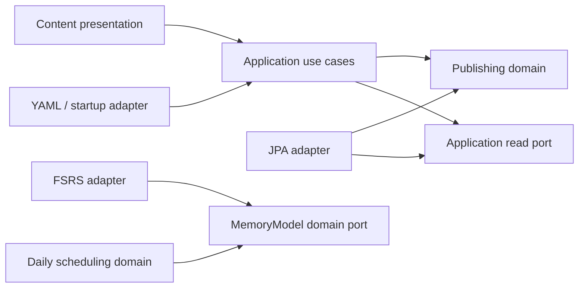

# Revue architecture

Revue is a modular monolith. Domain models describe publishing and daily scheduling. The Spring application, PostgreSQL, YAML source and React UI connect to those models through explicit boundaries.

## Domains and ownership

| Boundary | Current responsibility | Model and rules |
|---|---|---|
| Content | Publish and browse maintained public sets | `PublishedSet` owns its `PublishedCard` entities. Stable keys identify publications. Corrections raise content versions; removal retires content. A set's retirement preserves its active cards. Required sources and key ownership are publishing rules. |
| Reviews | Compute a daily scheduling recommendation | `DailyReviewScheduler` owns local-day normalization and the scheduling profile. `MemoryModel` describes what it needs from a memory algorithm. `ReviewRating` is independent of the FSRS library. |
| Identity | Configure session and access protection | Only infrastructure exists today. Account registration and an account domain model remain future work. |
| Platform | Serve the browser app and static assets | HTTP forwarding, compression negotiation, cache headers and the application clock are technical concerns. |

A published set is an aggregate: its public operations control changes to its cards. Card mutation methods are package-private. Publication input records are immutable values; changing a card's definition increments its content version once. Numeric database IDs and audit timestamps belong to persistence rows. They survive republishing and retirement.

`ContentRules` checks publication invariants, including globally unique card ownership. `ContentLoader` coordinates those checks, aggregate changes and repository saves in one transaction. The complete-source import intentionally spans sets so an invalid source never publishes a partial catalog. It runs at startup, not for every public read.

## Backend dependency direction

Each domain lives under `com.revue.<context>.domain`. It imports only its own model, the Java library and nullability annotations. It has no Spring, JPA, HTTP, YAML or FSRS-library dependencies.

Application code coordinates use cases and defines read ports and response projections. It may use Spring service and transaction annotations. It cannot import infrastructure or presentation. This keeps transaction boundaries visible without adding decorators that only delegate.

Adapters live under `infrastructure`: JPA rows/repositories map domain state onto the existing schema, the files adapter parses YAML, and `FsrsMemoryModel` implements the memory-model port. The public controller lives under `presentation` and handles HTTP status and cache headers using application results. It never returns a JPA entity.

Public browsing uses `PublicSetQueries` projections rather than loading whole aggregates. `PublicSetService` owns the five-card trial policy. Aggregate writes use `PublishedSetRepository`; its contract offers no shared-content deletion operation. The database deletion guard remains a second protection.

Contexts currently have no direct dependencies on each other. Add a narrow application contract when a real use case needs one. Keep another context's entities, persistence classes and third-party library types out of that contract.

## Frontend boundaries

- `app`: route composition and concrete adapter wiring.
- `features/catalog/application`: content projections, the `PublicContentReader` port and query definitions.
- `features/catalog/infrastructure`: the HTTP reader implementation.
- `features/catalog/presentation`: browsing screens and the provider that supplies the reader to presentation code.
- `features/study/domain`: rating meanings, immutable trial state transitions and illustrative summary grouping. These modules have no framework, browser or transport imports.
- `features/study/presentation`: React recall controls, trial rendering and rating styling.
- `shared`: common UI and navigation contracts.

The composition root supplies the HTTP reader. Presentation code uses the provider and application queries, rather than importing the HTTP implementation. Semantic rating meanings belong to the domain; colors and meter rendering stay in presentation. Trial ratings remain browser-only practice and never become saved reviews.

## Enforced boundaries and compatibility

`ArchitectureTests` checks Java domain purity, application/adapter direction, framework placement and context independence using ArchUnit. `frontend/src/architecture.test.ts` parses production TypeScript imports, including type imports and literal dynamic imports, to enforce the frontend boundaries. Nonliteral dynamic imports require an explicit architecture decision. The separate `tsconfig.domain.json` also checks domain code without DOM or framework globals. These checks run through ordinary `make check`.

Behavioral tests remain authoritative for public JSON, ordering, missing/retired content, mandatory sources, optional explanations, stable database IDs, content versions, no-op timestamps, transaction rollback and the unsaved trial. FSRS reference tests retain the same pinned library, configuration, state restoration and day-boundary examples.

This refactor preserves the current daily-only scheduling profile, which disables short-term learning/relearning steps. It adds neither persisted review submission nor short-term relearning. Focus Practice remains a candidate; it must use its own practice flow without changing normal schedules or review history.

The schema, published content, API URLs, browser URLs, UI and deployment settings are unchanged. New domain work should add only the models and ports its actual use cases require. Architecture checks enforce dependency rules; they do not replace review of domain meaning or behavior.
