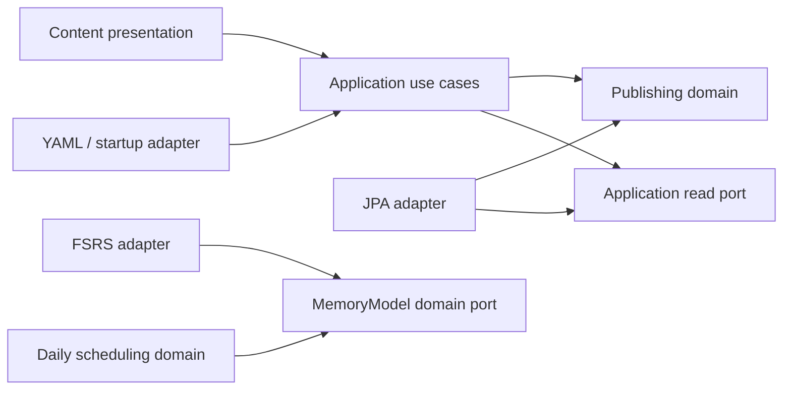

# Revue architecture

Revue is a modular monolith. Domain models describe publishing and daily scheduling. The Spring application, PostgreSQL, YAML source and React UI connect to those models through explicit boundaries.

## Domains and ownership

| Boundary | Current responsibility | Model and rules |
|---|---|---|
| Content | Publish and browse maintained public sets | `PublishedSet` owns its `PublishedCard` entities. Stable keys identify publications. Corrections raise content versions; removal retires content. A set's retirement preserves its active cards. Required sources and key ownership are publishing rules. |
| Reviews | Compute a daily scheduling recommendation | `DailyReviewScheduler` owns local-day normalization and the scheduling profile. `MemoryModel` describes what it needs from a memory algorithm. `ReviewRating` is independent of the FSRS library. |
| Identity | Configure session and access protection | Only infrastructure exists today. Account registration and an account domain model remain future work. |
| Platform | Serve the browser app and static assets | HTTP forwarding, compression negotiation, cache headers and the application clock are technical concerns. |

A published set is an aggregate: its public operations control changes to its cards. Card mutation methods are package-private. Publication input records are immutable values; changing a card's definition increments its content version once. Numeric database IDs and audit timestamps belong to persistence rows. They survive republishing and retirement.

`ContentRules` checks publication invariants, including globally unique card ownership. `ContentLoader` coordinates those checks, aggregate changes and repository saves in one transaction. The complete-source import intentionally spans sets so an invalid source never publishes a partial catalog. It runs at startup, not for every public read.

## Backend dependency direction

Each domain lives under `com.revue.<context>.domain`. It imports only its own model, the Java library and nullability annotations. It has no Spring, JPA, HTTP, YAML or FSRS-library dependencies.

Application code coordinates use cases and defines read ports and response projections. It may use Spring service and transaction annotations. It cannot import infrastructure or presentation. This keeps transaction boundaries visible without adding decorators that only delegate.

The application allowlist permits `@Service`, `@Transactional` and its `Propagation`/`Isolation` settings. It does not permit arbitrary Spring types. Security, session and mail integrations stay in infrastructure. Infrastructure cannot depend on presentation.

Adapters live under `infrastructure`: JPA rows/repositories map domain state onto the existing schema, the files adapter parses YAML, and `FsrsMemoryModel` implements the memory-model port. The public controller lives under `presentation` and handles HTTP status and cache headers using application results. It never returns a JPA entity.

Public browsing uses `PublicSetQueries` projections rather than loading whole aggregates. `PublicSetService` owns the five-card trial policy. Aggregate writes use `PublishedSetRepository`; its contract offers no shared-content deletion operation. The database deletion guard remains a second protection.

Publication loads a catalog once per import transaction. Its adapter keeps the loaded rows in that catalog and reuses them when saving, so a repeat import needs only one set query and one card query. Catalog state belongs to that import, rather than the singleton repository.

Contexts currently have no direct dependencies on each other. Add a narrow application contract when a real use case needs one. Keep another context's entities, persistence classes and third-party library types out of that contract.

## Frontend boundaries

- `app`: route composition and concrete adapter wiring.
- `features/catalog/application`: content projections, the `PublicContentReader` port and query definitions.
- `features/catalog/infrastructure`: the HTTP reader implementation.
- `features/catalog/presentation`: browsing screens and the provider that supplies the reader to presentation code.
- `features/study/domain`: rating meanings, immutable trial state transitions and illustrative summary grouping. These modules have no framework, browser or transport imports.
- `features/study/presentation`: React recall controls, trial rendering and rating styling.
- `shared`: common UI and navigation contracts.

The composition root supplies the HTTP reader. Presentation code uses the provider and application queries, rather than importing the HTTP implementation. Semantic rating meanings belong to the domain; colors and meter rendering stay in presentation. Trial ratings remain browser-only practice and never become saved reviews.

## Shared learning and private progress

Social cohesion is a core product goal. The intended network effect is that useful participation improves the shared material or support available to other learners; this remains a hypothesis to validate. The architecture supports one maintained publication with independent learner state. Identity owns eligibility, content owns publication and attribution, and reviews owns individual schedules and history. Account-owned learning and report/correction use cases remain planned.

A public link or signup invitation grants no access to another learner's progress and creates no implicit group membership. The pilot uses existing sharing channels and explicit saving when implemented. Add collaboration contracts only for concrete use cases; no group platform, public learner profile or additional permission system is required before account creation.

## Account foundation and remaining layers

M2.1a implements the account foundation in the existing `identity` context. Pure domain values own canonical email, invitation validity, eligibility and deletion rules. `RegistrationCommit` saves a pending account, invite redemption and initial verification challenge in one transaction through the application-owned `RegistrationStore` port. It grants no learner session. Public signup, verification, sign-in, reset and deletion workflows remain unimplemented.

The JPA adapter locks the invitation and uses PostgreSQL conflict handling for expected email/digest collisions. Email uniqueness is enforced by the database, so two different invitations cannot race past a preliminary lookup. A duplicate registration never overwrites credentials or consumes another invitation. The clock is read after acquiring the invite lock, and any failed save rolls back all three changes. No credential hashing, provider call or session effect occurs inside this transaction.

V4 adds UUID account/invitation/challenge IDs, independent eligibility facts and all-or-none deletion fields. It preserves existing content and session data. Account erasure cascades to private challenges and clears the invitation's user link while retaining its redemption timestamp. The actual erasure use case, deletion journal, cleanup worker and restore procedure remain M2.3 work. Domain deletion cancellation requires the current request and credential version, advances that version and preserves every other restriction; its future application caller must authenticate the proof and hold the account lock.

The pilot email key trims outer ASCII whitespace and lowercases ASCII dot-atom addresses with DNS domains. Dots and plus aliases remain significant; quoted local parts and internationalized addresses are not supported in this slice. Password encodings retain their algorithm prefix and are never normalized as email. Token digests are SHA-256 hex values; raw token generation and password encoding remain adapter work for M2.1b. Diagnostic strings redact email and credential/digest values.

Deletion recovery lasts seven elapsed days. The foundation also uses the plan's proposed seven-day unverified-registration lifetime, measured from creation; no cleanup runs yet. A pending deletion window takes precedence over unverified cleanup. Verification challenge expiry is supplied by trusted preparation and rechecked at commit; its delivery policy belongs to M2.1b.

The dependency direction remains presentation -> application -> domain, with infrastructure implementing inward-owned ports. Responsibilities across the account slices are:

| Layer | Account responsibility |
|---|---|
| Domain | Account eligibility and lifecycle, invitation/challenge invariants, password policy and deletion deadlines; no framework or transport types |
| Application | Registration, verification, authentication, recovery and deletion use cases; short atomic commits and outbound ports |
| Infrastructure | JPA mapping, password/token tools, Spring Security sessions/CSRF/MFA, email execution/provider integration and scheduled triggers |
| Presentation | Transport DTOs, bounded request parsing, calling application contracts and HTTP/error mapping |

Keep hashing and email/provider work outside database transactions. Commit account/invite/challenge mutations through a real transactional application boundary, then request delivery/session effects. Recheck current status and credential version before accepting authentication, and check the session's credential version on private access so a reset does not rely solely on session eviction.

Account eligibility is derived from separate verification/agreements, suspension and deletion facts. Cancelling deletion removes only that restriction. Increment the existing credential version for access-invalidating lifecycle changes so failed session eviction cannot revive an old session after cancellation. Restricted sessions retain their allowed purpose, and session completion carries the validated application result version, including the new committed version after an authorized cancellation. It never replaces a delayed result with the latest version.

Pilot signup uses one persisted single-use invitation, redeemed in the same short transaction as the unique account and verification challenge. Retries cannot consume another invitation or overwrite credentials. Erasure removes identifying invitation links without making a consumed token reusable. These are planned domain/application invariants with database constraints and concurrency tests, not new middleware or a separate service.

Keep the pilot implementation small: account foundation, signup/verification, login/recovery and explicit saving are separate review units. Administrative MFA/elevation belongs to admin writes, not routine learner signup or study.

Account purge uses narrow application ports implemented by the data-owning contexts. All per-account erasure participants join the same database transaction and preserve shared publications. Identity does not import their persistence repositories. Add only the concrete cross-context port exceptions this workflow requires.

Frontend account presentation uses injected application contracts; HTTP/CSRF details remain in infrastructure. The app wires adapters, shared UI remains independent, and the backend owns permission and lifecycle decisions. Add pure client-domain modules only when real behavior needs them.

Java architecture tests discover every implemented context's domain and application packages, including future identity layers. Test-only identity fixtures prove that legitimate inward dependencies pass and framework, adapter and foreign-context dependencies fail. There are no cross-context erasure exceptions yet; add only the exact implemented seams when needed. These dependency checks supplement domain and PostgreSQL registration tests; they do not certify unbuilt authentication or authorization.

## Enforced boundaries and compatibility

`ArchitectureTests` checks Java domain purity, application/adapter direction, framework placement and context independence using ArchUnit. It discovers contexts from production classes and fails if no domain or application classes are checked. `ArchitectureGuardTests` runs the same rules against valid and invalid test-only examples.

`frontend/src/architecture.test.ts` inspects every production `.ts`/`.tsx` file under `src`, excluding test files and test helpers. Production imports of those excluded files are forbidden. Files must live in `app`, a named feature layer or `shared`, with `main.tsx` as the browser entry point. Feature-layer rules apply only under `features/<name>/<layer>`; shared remains independent of features regardless of its subfolder names. It parses imports, re-exports, inline import types, import-equals declarations and literal dynamic imports. Feature layers and shared code cannot import the composition root; presentation and infrastructure cannot import each other. Nonliteral dynamic imports require an explicit architecture decision.

Frontend domain modules use `.ts`; `.tsx` is forbidden there. The separate `tsconfig.domain.json` checks those modules without DOM or framework globals. These checks run through ordinary `make check`.

Behavioral tests remain authoritative for public JSON, ordering, missing/retired content, mandatory sources, optional explanations, stable database IDs, content versions, no-op timestamps, transaction rollback and the unsaved trial. FSRS reference tests retain the same pinned library, configuration, state restoration and day-boundary examples.

This refactor preserves the current daily-only scheduling profile, which disables short-term learning/relearning steps. It adds neither persisted review submission nor short-term relearning. Focus Practice remains a candidate; it must use its own practice flow without changing normal schedules or review history.

M2.1a adds account tables only. Published content, API URLs, browser URLs, UI and deployment settings are unchanged. New domain work should add only the models and ports its actual use cases require. Architecture checks enforce dependency rules; they do not replace review of domain meaning or behavior.
